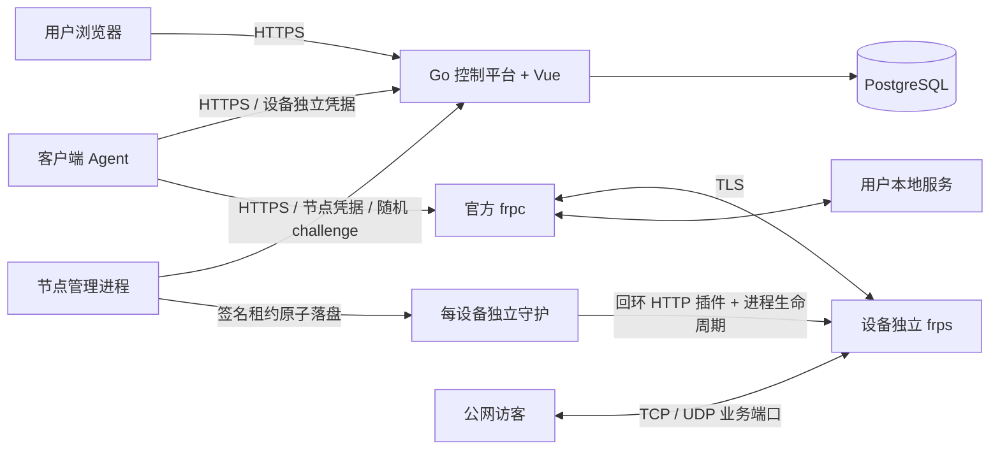

# 架构、版本依据与阶段计划

核实日期：2026-10-23。核实通过官方 GitHub Release API、固定 tag 源码、官方二进制和本机执行完成。没有采用开发分支，没有复用 frp-panel、Sakura Frp 或 ngrok 的代码、品牌和素材。

## 1. 上游锁定和依据

| 项目 | 结果 |
|---|---|
| FRP 版本 | [v0.71.1](https://github.com/fatedier/frp/releases/tag/v0.71.1)，2026-10-14 09:52:45 UTC 发布 |
| 源码定位 | tag 对应提交短 SHA 72d643d；源码和二进制版本均核实 |
| 上游许可 | [Apache-2.0 LICENSE](https://github.com/fatedier/frp/blob/v0.71.1/LICENSE)，原文保存在 third_party/frp-LICENSE；该源码树未发现独立 NOTICE 文件 |
| 发行包 SHA256 | third_party/frp-lock.json 保存官方 Release API 的 digest；下载脚本逐字节校验 |
| 内核修改 | 无；调用独立二进制、HTTP 插件，外围守护强制失效 |
| 编译器 | 本机下载并校验官方 Go 1.27.3 Windows amd64 压缩包；模块最低 go 1.27.0 |
| 数据库 | PostgreSQL 17.6 Windows x64 实际测试；生产补丁升级须单独回归 |

FRP 所需 Go 版本、其依赖与主项目不同；本项目使用官方 FRP 发行二进制，不把上游完整模块编译进控制平台。依赖许可证记录见 third_party。

## 2. 逐项能力核实

| 能力 | v0.71.1 官方依据 | 本项目用法和边界 |
|---|---|---|
| Token / OIDC | [frps 配置](https://github.com/fatedier/frp/blob/v0.71.1/conf/frps_full_example.toml)、pkg/auth | 使用独立设备 token；OIDC 不接入。auth.additionalScopes 实际支持 HeartBeats、NewWorkConns |
| 强制 TLS | 同上 transport.tls.force、certFile、keyFile | 每个 frps 强制 TLS，frpc 配 trustedCaFile 与 serverName；不跳过证书验证 |
| 限制端口 | 同上 allowPorts、maxPortsPerClient | 每台设备精确业务端口白名单；无隧道不启动 frps，避免空 allowPorts 的不限制语义 |
| 插件鉴权 | [HTTP 插件协议](https://github.com/fatedier/frp/blob/v0.71.1/pkg/plugin/server/types.go)、[HTTP 实现](https://github.com/fatedier/frp/blob/v0.71.1/pkg/plugin/server/http.go) | 插件监听独立回环随机端口与随机路径；Login、Ping、NewWorkConn、NewProxy、NewUserConn 检查本地短租约；NewProxy 还精确校验隧道/协议/端口 |
| 服务端限速 | [NewProxy 消息](https://github.com/fatedier/frp/blob/v0.71.1/pkg/msg/msg.go)、[proxy.go](https://github.com/fatedier/frp/blob/v0.71.1/server/proxy/proxy.go) | 插件覆盖 bandwidth_limit 和 bandwidth_limit_mode=server，拒绝客户端自建 group。每隧道独立 limiter，账户多隧道带宽会相加；不是账号总带宽 |
| 带宽单位 | [types.go](https://github.com/fatedier/frp/blob/v0.71.1/pkg/config/types/types.go) 明确 KB=1024、MB=1024² | API 字段 tunnel_kibps，前端显示 KiB/s。1 MiB/s=8.388608 Mbps，Mbps 的 M 为十进制。速率不是累计流量 |
| 配置变更 | 官方 frpc 配置管理；本项目无需依赖其远程动态接口 | 平台有稳定配置摘要；Agent 拉取、原子写文件、重启 frpc；节点配置改变重启隔离 frps。同设备已有连接中断，端口不变 |
| 关闭已有连接 | [API 路由源码](https://github.com/fatedier/frp/blob/v0.71.1/server/api_router.go) 的公开路由主要查询状态和清理离线记录 | 未把删除离线代理记录当作在线连接撤销。本项目关闭设备独立 frps 进程，已用原生 frpc 实测 TCP 已有连接终止、UDP 不再转发 |
| 监控 | 同上查询 /api/serverinfo、/api/traffic/{name}、v2 clients/proxies 等；enablePrometheus 输出监控 | 当前未开启 FRP 管理 HTTP 服务，不暴露 dashboard。未实现持久流量账本，不使用重启丢失的指标进行扣费 |

本版本没有虚构 `/kick-client` 或任意通用“断连 API”。后续升级上游必须重新核实协议字段及 API，运行插件测试和原生二进制 E2E，不能只修改版本字符串。

## 3. 架构与失效模型

用户流量直接经过节点，控制平台不转发业务数据。每个**已绑定且有启用隧道的设备**占一个 frps 进程和一个公网 TCP 控制端口；每个业务端口只分给一个隧道（TCP/UDP 共用一套分配池，保守地避免双协议重叠）。第一阶段不是共享单 frps 的大规模调度方案。

控制平台使用 Ed25519 签名，节点仅持有验证公钥。设备 FRP token 通过平台私有种子与设备 ID/凭据代际 HMAC 派生，不等于用户会话或设备 API token，也不是所有用户共用的管理密码。节点凭据泄漏只允许读取该节点租约与授权 token，仍须立即维护节点、轮换凭据并排查。

节点每 2 秒获取租约，带随机 nonce 防重放；租约最多 15 秒。守护每 200ms 检查失效，实际允许期限取租约截止与套餐截止中较早者，使用本地单调时间计时防止已建立租约因系统时钟回拨而延长。新签名租约须在允许的时钟窗口内。节点与数据库、控制平台应同步 NTP，偏差控制在 1 秒内；持续时钟漂移将导致拒绝服务，不能保证恶意控制本机时钟下的安全。

正常轮询撤销常见约 2–5 秒，控制故障或轮询失败时上限按 **15 秒租约 + 200ms 检查 + 调度余量，产品约定 16 秒**。这是正常调度/操作系统可运行条件下的设计边界，进程被冻结、主机休眠等场景需要系统看门狗及运营监控。本机控制平台断开 E2E 已测量停止时间；Linux 内核/主机故障场景尚未实测。

Windows 子进程加入 KILL_ON_JOB_CLOSE Job Object，Linux 子进程设置 Pdeathsig=SIGKILL；systemd 额外 KillMode=control-group。节点重启不从磁盘恢复过期授权，必须获取新的有效签名租约。守护对已落盘租约独立验证签名、节点身份、有效期及签发时间递增。

Login、NewProxy、NewWorkConn 与 TCP NewUserConn 还必须在线访问 `/api/node/check`，超时 1 秒或失败默认拒绝新授权；Ping 可在既有租约内维持。故障时已有连接最多运行到本地租约截止。UDP 已建代理的数据报不是逐包触发 NewUserConn，按租约停止整个 UDP 转发。在线检查增加每次新 TCP 连接的控制面请求及延迟，当前每来源节点接口限流 6000 次/分钟；正式扩容前应测量连接建立率并设计可签名的短期连接票据，避免控制平台成为连接建立瓶颈。

## 4. 支持矩阵

| 组件 | Windows amd64 | Linux amd64 | Linux arm64 | 其他 |
|---|---|---|---|---|
| Go 控制平台 | 本机编译、运行、PostgreSQL/API 验证 | 交叉编译；未实机部署 | 交叉编译；未实机部署 | 尚不承诺 |
| 官方 frps 节点 + 守护 | 真实 TCP/UDP、租约失效、进程清理验证 | 上游发行包存在并锁定；守护交叉编译；未实测 | 同左 | 尚不承诺 |
| CLI Agent + 官方 frpc | 绑定、配置生成、TCP/UDP、诊断验证 | 交叉编译；未实机部署 | 交叉编译；未实机部署 | 尚不承诺 |
| 桌面 GUI | 未实现 | 未实现 | 未实现 | 未实现 |
| 浏览器用户中心/后台 | 响应式 Web；构建验证 | 同一静态前端 | 同左 | 现代浏览器；移动端布局待实机验证 |

目标最低系统：Windows 10/Server 2016 及以上 x64；Linux 建议受支持的 Debian 12/Ubuntu 22.04+，内核至少 3.2（Go 目标要求），systemd 模式需要 systemd。Linux portal 为 CGO_ENABLED=0；官方 frp 的平台最低要求还需目标机执行验证。较老 Windows、32 位、ARMv7、ARM soft/hard float ABI 均不在首期矩阵。

macOS Intel/Apple Silicon、Windows arm64、NAS、OpenWrt(procd)、launchd 尚未实现安装服务及生命周期验证。Android/iOS 有后台与分发限制，单独评估。CLI 不要求图形桌面；GUI 尚未交付。不能把上游发行资产存在等同于整个产品已经兼容。

## 5. 数据模型与并发规则

| 表 | 关键约束/作用 |
|---|---|
| users / sessions | 邮箱唯一；bcrypt cost 12；会话摘要、12h 有效期；super/operator/user；禁用即时阻断 API |
| nodes | 独立凭据摘要；业务/控制端口池不重叠；enabled 与 last_seen |
| plans | 固定规则快照，绑定单节点；设备数/账号总隧道数/每隧道带宽，参考价格；不提供修改接口 |
| entitlements | user_id 唯一，plan_id 与 UTC expires_at；同套餐叠加 |
| batches / cards | 批次名称、备注、截止、固定秒数、套餐；卡摘要主键、禁用标记；不保存卡明文 |
| redemptions | card_hash 唯一，(user_id,request_id) 唯一；before/after/user/batch/created_at 不可通过 API 删除 |
| adjustments | 独立增减时长与原因、操作者、调整前后时间；不删除兑换历史 |
| bind_codes | 160 位随机、5min、摘要、used；一次性绑定 |
| devices | 独立 API token 摘要、generation、撤销；(node_id,control_port) 唯一 |
| tunnels | 属主、设备、节点、TCP/UDP、本地/远程端口、暂停；(node_id,remote_port) 唯一 |
| audit / schema_versions | 管理和权益操作审计；数据库迁移版本 |

兑换统一先锁 users 行，再锁 cards 行：同用户不同卡不会丢失续费，同卡跨用户不会重复发放。读取数据库 clock_timestamp() 发生在拿到锁之后。事务一次提交权益、兑换流水与审计。同卡同用户响应丢失后可用原 request_id 或新 request_id 返回既有流水，不二次加时；同一 request_id 换另一张卡被拒绝。

端口分配先锁用户，再锁节点行，用 generate_series 找空闲，并由数据库唯一约束兜底。撤销设备保留原控制端口以防旧凭据与新设备混淆；本版没有设备归档和控制端口回收流程，较小池长时间运营会耗尽。业务隧道删除后业务端口可再分配；前一进程释放需要轮询时间，短暂 bind 冲突会记录日志并在下一轮重试。

## 6. 计费口径和阶段边界

销售单位是**有效时长**；自然经过时间、离线消耗、固定秒数。暂停隧道不暂停时长。没有自然月产品、自动重置流量、在线支付或支付回调。价格只是套餐参考字段；卡生成数量不代表销售收入，兑换数量不代表收款，不提供虚构收入统计。

设备数与隧道数按全账号聚合；设备数统计未撤销的绑定设备，不是动态在线设备数。套餐固定单节点，不支持跨节点聚合。带宽按单隧道上游 limiter（双向读写共用该 limiter）实施；没有账号总带宽/账号并发连接限额。流量额度、周期、倍率、额外包、预分配和持久消费账本均未实现，不能以当前监控进行按流量收费。

阶段 1：本次交付的时长卡、独立设备、TCP/UDP、有限租约停止、中文 UI、CLI、安装文档与测试。

阶段 2：持久流量流水（node_id/boot_id/sequence/cumulative）、额度预分配及最大超用窗口、账号聚合限速/并发、生产告警与度量、证书轮换、配置下发/应用回执、邮件验证找回、设备凭据原位轮换与控制端口回收、连接级故障关闭策略、容量压力与多平台实机验收。

阶段 3：HTTP/HTTPS（先归属验证、租户域名保护，明确透传与终止 TLS）、多节点调度与显式迁移、桌面 GUI、独立在线支付模块及回调校验、代理商/企业子账号。STCP/XTCP/P2P 需单独兼容性验证；P2P 不能承诺必达，TCP 会话迁移不能承诺无损。
